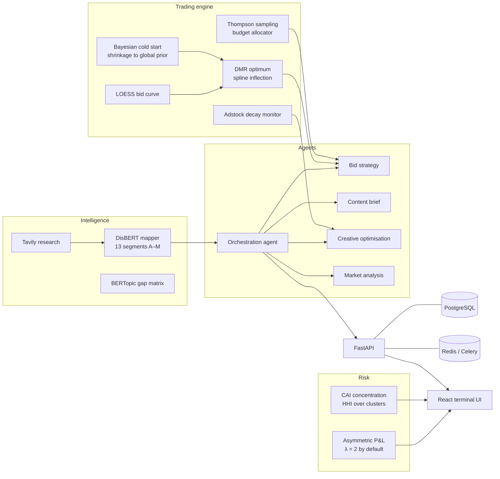

# SIGNAL: a trading engine for paid media

Paid media teams still set bids and move budget by hand, so a new campaign with no history bids on noise and a platform that had one good week keeps the money.

SIGNAL sets bids and splits a budget the way a trading desk would: the statistics decide where the money goes, and a person still makes the creative and strategic calls.

*Built at the Cursor AdTech hackathon, 1st place. See [HACKATHON.md](HACKATHON.md).*

## What it does

- **Where should the bid sit?** It fits a curve of bid against conversion rate and bids just below the point where extra spend stops paying off.
- **What if there's barely any data?** A cluster with fewer than 50 observations uses a global prior instead of its own curve, and every cluster is blended towards that prior.
- **How should budget be split?** Thompson sampling allocates across platforms under uncertainty, then applies floors and caps.
- **When is creative wearing out?** It fits how quickly an ad's effect decays and suggests whether to hold, reduce or rotate it.

Five LLM agents turn those numbers into bid decisions, content briefs and creative suggestions. They are registered with Overmind and, when `CURSOR_API_KEY` is set, run through the Cursor SDK.

## How it works



1. **Intelligence.** Tavily research is mapped onto 13 DisBERT segments, A to M. Each segment has a fixed commercial-intent score, from 0 for the blocked segment to 0.95 for purchasable products. BERTopic can group documents into a gap matrix.
2. **Bid discovery.** For a cluster, LOWESS smooths bid against conversion rate. A spline is fitted to that curve and the bid is set just below the inflection, where marginal returns turn down.
3. **Cold start.** The shrinkage weight is `n / (n + 30)`. Below 50 observations the cluster does not get its own curve; the prior stands in for it.
4. **Allocation.** Each platform keeps a Beta posterior. A draw from each posterior sets the raw split. Floors and caps are applied, and any budget still unspent is shared across platforms that are under their cap.
5. **Agents.** Five agents are registered in `.overmind/agents.toml`. The trigger service also knows keyword classification, Tavily research and campaign allocation. A person reviews what they return.

## Technical highlights

- **Bid optimum** (`services/trading/bid_discovery.py`). `statsmodels` LOWESS smooths the curve (`frac` 0.3). A `UnivariateSpline` is fitted and `brentq` finds where the second derivative crosses zero. The bid is that point times a buffer, 0.92 by default. If the second derivative does not change sign, the bid is the point of steepest slope instead. With fewer than five points the optimum is the mean bid. With fewer than ten points the curve is left unsmoothed. Confidence is marked high from 50 points.
- **Bayesian cold start** (`BayesianColdStart`, same file). Weight `n / (n + pseudo_count)` blends a cluster's own optimum with the global mean. The default pseudo-count is 30, and the same weight is reported as confidence. Below `min_observations` (50) the cluster optimum is replaced by the global mean before that blend.
- **Thompson sampling** (`services/trading/thompson_allocator.py`). Each platform starts at Beta(2, 2). Budget is split in proportion to a draw from each posterior. A floor is a minimum and a cap is a maximum. Leftover budget is split equally across platforms still under their cap.
- **Adstock decay** (`services/trading/adstock_decay.py`). `scipy.optimize.curve_fit` fits daily conversions to `initial * λ^t`. λ above 0.7 is hold, above 0.4 is reduce, and otherwise exit. Fewer than three points returns a monitor signal and λ of 0.5. Half-life and a rotation note come from the same fit.
- **Asymmetric P&L** (`services/analytics/asymmetric_pnl.py`). Wasted impressions and wasted clicks are costed, then multiplied by λ (2 by default) before they are subtracted from conversion value. The same module turns that score into an attention-token reward or burn. There is no separate token service.
- **Concentration risk** (`services/analytics/cai_risk.py`). A Herfindahl–Hirschman index of impression share per cluster, compared with a target that depends on the campaign goal.
- **Intent-weighted bids** (`services/trading/thrad_contextual_bid.py`). A base bid is multiplied by a weight from the campaign goal and the classified intent of the prompt.
- **Agents** (`services/agents/`). Overmind entry points live in `services/agents/overmind/`. The registry is `.overmind/agents.toml`.

Position records use the platform names Meta, Google and Thrad (`shared/models/media_position.py`). Connectors exist for Meta Ads, Google Ads and the Thrad bid API. The allocator itself takes whatever platform names you pass in. The trigger service's fallback bidder list is Google, TikTok and Microsoft, which is a different set.

## Finding your way around

```text
api/                 FastAPI app (api/main.py) and route modules
services/
  trading/           bid discovery, cold start, Thompson allocator, adstock, intent bids
  analytics/         asymmetric P&L, concentration risk
  intelligence/      Tavily research, DisBERT mapping, BERTopic
  agents/            LLM agents and Overmind entry points
  media_buying/      buying flow (router not mounted)
  media_planning/    planning helpers
  planning/          planning flow (router not mounted)
  platform_integration/   Google Ads, Thrad bid API, Meta connector
shared/              settings, models, Overmind tracing, background tasks
frontend/            React + TypeScript + Vite terminal UI
scripts/             database setup, Gymshark sample data, manual smoke scripts
tests/               offline pytest suite for the trading maths
alembic/             migration config and the initial revision
docs/                architecture notes, technical spec, agent briefs
```

Longer notes live in `docs/ARCHITECTURE.md`, `docs/signal_technical_spec.md` and `docs/LLM_ARCHITECTURE.md`.

## Testing and quality

- The offline suite is `tests/`. It covers the bid curve, cold start, Thompson sampling, adstock decay, asymmetric P&L and concentration risk. It does not call Tavily, the Cursor SDK, Overmind or a database.

  ```bash
  pip install -e ".[dev]"
  pytest
  ```

  pytest is a dev dependency. `make test` runs the same suite with coverage.
- `scripts/test_*.py` are still manual smoke scripts. They talk to live services.
- The schema is the Alembic revision in `alembic/versions/`. `make db-migrate` (or `alembic upgrade head`) applies it. `python scripts/init_db.py` creates the same tables from the SQLAlchemy models and creates the Postgres extensions. `scripts/init-db.sql` creates those extensions when the Docker database is first initialised. `.gitignore` used to ignore `alembic/versions/*.py`, which is why no revision had been committed.
- In `api/main.py` the demo, planning, media-buying, Cursor and chat routers are commented out. Intelligence, the terminal, agent triggers and connectors are mounted. The demo, planning and media-buying routers were commented out on 28 May 2026, in the same commit that added agent triggers.
- There is no `services/token` package. Attention-token scoring is `services/analytics/asymmetric_pnl.py`. Token tables are `shared/models/token.py`.
- `make db-seed` calls `scripts/seed_db.py`, which is not in the repo. Sample data is `python scripts/demo_data.py`. `scripts/setup_demo.sh` is not in the repo either.
- `classify_query_with_disbert` assigns a segment by keyword match. The function says a live model would replace that in production. `ThradBERTClient` defaults to demo mode. The intent classifier in `services/intelligence/bertopic_gap_matrix.py` loads a model from a path under `/Users/molyleelatham/.cache/`, so it will not start on another machine until that path is changed.
- The Gymshark data in `scripts/demo_data.py` is sample data, not a live ad account.

## Stack

Python 3.11, FastAPI, SQLAlchemy, Alembic, PostgreSQL, Redis and Celery, statsmodels, SciPy, scikit-learn, BERTopic, sentence-transformers, Transformers and PyTorch, Tavily, the Cursor SDK and Overmind. The front end is React, TypeScript, Vite, Tailwind and TanStack Query.

## Running it locally

```bash
git clone https://github.com/molyleelatham/signal-agentic-paid-media.git
cd signal-agentic-paid-media
cp .env.example .env
pip install -e ".[dev]"

make db-up                    # PostgreSQL and Redis
alembic upgrade head          # or: python scripts/init_db.py
python scripts/demo_data.py   # optional Gymshark sample data

uvicorn api.main:app --reload # API docs at http://localhost:8000/docs

cd frontend && npm install && npm run dev   # http://localhost:5173
```

`.env.example` uses the same database user as `docker-compose.dev.yml` (`signal_user` / `signal_pass`, database `signal`).

The agents need `CURSOR_API_KEY`. Overmind's own setup and optimiser need `OPENAI_API_KEY` and `OVERMIND_API_KEY`, in `.env` and in `.overmind/.env`. See `docs/LLM_ARCHITECTURE.md`. There is no `scripts/bootstrap_overmind_env.py`.
